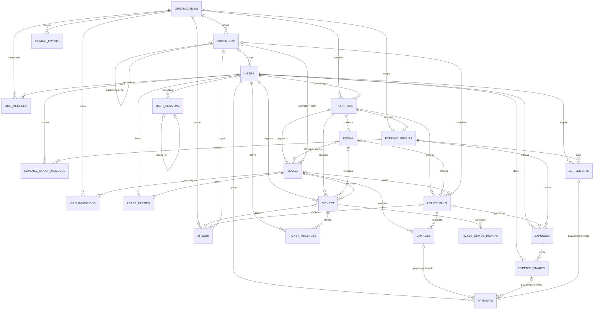

# 03 — Modello dati

PostgreSQL **16 o superiore**. Il minimo non è arbitrario: le viste applicative
usano `security_invoker`, introdotto in 15, senza il quale una vista girerebbe con
i diritti del proprietario e aggirerebbe la Row Level Security del chiamante.

Numeri dello schema attuale: **23 tabelle** di business più `audit_log`
partizionata, **35 enum**, **4 domini**, **169 indici**, **59 policy RLS**,
**49 trigger**, **4 viste**, **25 funzioni**, **16 migration**.

## Diagramma ER

`DOCUMENTS` è allegabile a qualunque aggregato tramite `(owner_type, owner_id)`
senza foreign key: il diagramma mostra solo i riferimenti tipizzati. Vedi
[Riferimenti polimorfici](#riferimenti-polimorfici).

## Convenzioni dello schema

| Convenzione | Motivo |
|---|---|
| Tutto nello schema `app`, sempre qualificato | Nessuna dipendenza dal `search_path` di chi esegue |
| Chiavi primarie `UUID`, generate come **v7** dal codice Rust | La componente temporale iniziale rende gli insert nel B-Tree quasi append-only invece di sparsi, e ordinare per id equivale a ordinare per data di creazione — che è ciò che rende possibile la paginazione keyset |
| `org_id NOT NULL` su ogni tabella di business | È il confine di isolamento su cui filtrano le policy RLS |
| `created_at`, `updated_at`, `deleted_at` | `updated_at` lo scrive un trigger, non le query |
| Domini invece di tipi grezzi | `app.money_amount`, `app.currency_code`, `app.email_address`, `app.percentage`, `app.confidence`, `app.country_code`: un unico posto dove cambiare precisione e validazione |
| Enum PostgreSQL per stati e classificazioni | Mai per permessi calcolati, che vivono nelle policy e nel service layer |
| Indici con `org_id` in testa | La RLS filtra per organizzazione, il planner sfrutta il prefisso |
| Indici parziali `WHERE deleted_at IS NULL` | Restano piccoli anche con molto storico |
| Unique parziali sul "vivo" | Email e slug si liberano dopo un soft delete |
| Colonne piatte per l'indirizzo, non JSONB | `city` e `postal_code` sono filtri di primo livello con indici propri |
| `metadata JSONB` per estensioni non filtrate | Evita `ALTER TABLE` per ogni campo accessorio |

## Row Level Security

### Contesto

Il collegamento fra applicazione e policy è la funzione
`app.set_request_context(user_id, org_id, platform_admin, request_id, client_ip, user_agent, actor_role)`,
che imposta variabili di sessione con `set_config(..., is_local => true)`. Il
`true` conta: il contesto muore con la transazione e non può filtrare fra
richieste che riusano la stessa connessione del pool.

Le policy **non si fidano** di quelle variabili. `app.member_role(org_id)` rilegge
la membership da `org_members`, quindi un `org_id` falsificato non concede accesso:
è verificato da un test di integrazione che imposta un contesto con
un'organizzazione di cui l'utente non è membro e si aspetta zero righe.

### Modello a due livelli

1. **Isolamento per organizzazione** — `org_id = app.current_org_id()` più
   membership verificata nel database.
2. **Visibilità per ruolo** — lo staff (`owner`, `manager`) vede tutta
   l'organizzazione; l'inquilino vede solo ciò che è legato ai propri contratti e
   gruppi di spesa.

### Funzioni di accesso

`app.member_role`, `app.is_org_member`, `app.is_org_staff`, `app.shares_org_with`,
`app.can_access_property`, `app.can_access_lease`, `app.can_access_ticket`,
`app.can_access_expense_group`, `app.can_access_attachment`.

Sono `SECURITY DEFINER` per una ragione precisa: una policy che interroghi in linea
una tabella a sua volta protetta da RLS ricorre su se stessa. Leggendo come
*definer* — che è il proprietario delle tabelle, ed è esente dalle policy — la
ricorsione non si presenta.

Ne seguono due conseguenze da non violare:

- **`FORCE ROW LEVEL SECURITY` non va mai abilitato** su queste tabelle:
  applicherebbe le policy anche al proprietario e la ricorsione tornerebbe. C'è un
  controllo statico che lo verifica.
- Le funzioni hanno `SET search_path = app, pg_temp`. Un `SECURITY DEFINER` senza
  `search_path` fissato è una scalata di privilegi in attesa. Controllo statico
  anche per questo.

Sono dichiarate `COST 500`: comunica al planner che sono costose, così i predicati
indicizzabili vengono valutati prima. Verificato con `EXPLAIN`: il confronto su
`org_id` diventa un *One-Time Filter* valutato una volta per query, non per riga.

### Le policy non filtrano il soft delete

PostgreSQL applica le policy di SELECT **anche alla riga nuova** di un `UPDATE`:
non si può scrivere una riga che poi non si potrebbe rileggere. Con
`deleted_at IS NULL` dentro una policy di SELECT, valorizzare `deleted_at`
produrrebbe una riga invisibile a chi la scrive, e il soft delete fallirebbe.

Le policy esprimono quindi solo l'isolamento; il filtro sta nel `WHERE` delle
query e nelle viste. Storia completa in [ADR-008](08-decisioni.md#adr-008).

## Ruoli del database

Creati da `ops/sql/roles.sql`, che gira una volta per cluster come superuser
(`CREATE ROLE` è cluster-wide e non appartiene a una migration di schema).

| Ruolo | RLS | Privilegi | Uso |
|---|---|---|---|
| `propflow_migrator` | esente (proprietario delle tabelle) | DDL completo | migration; è il *definer* delle funzioni di accesso |
| `propflow_app` | **soggetta** | `SELECT`, `INSERT`, `UPDATE`. Niente `DELETE` | servizio HTTP |
| `propflow_worker` | `BYPASSRLS` | anche `DELETE` | dispatcher outbox, worker AI, flussi pre-autenticazione |

`propflow_app` **non deve possedere tabelle**: il proprietario di una tabella è
esente dalle policy, quindi renderlo proprietario disattiverebbe silenziosamente
tutto l'isolamento.

`DELETE` non concesso significa che il soft delete non è una convenzione ma un
vincolo: un `DELETE` fallisce a runtime con `permission denied`. Verificato da un
test.

Nessuno dei tre può scrivere su `audit_log`: la traccia la scrive il trigger, che
è `SECURITY DEFINER`.

## Soft delete

`deleted_at TIMESTAMPTZ NULL` sulle entità di business. Una riga cancellata resta,
perché contratti, addebiti e audit continuano a riferirsi a essa e devono restare
leggibili.

Conseguenze operative:

- ogni query che legge entità con soft delete **deve** filtrare
  `deleted_at IS NULL`: la RLS non lo fa più (vedi sopra);
- le foreign key usano `RESTRICT` sui dati contabili e `CASCADE` solo sui figli di
  proprietà (quote, allegati, messaggi);
- gli indici unique sono parziali sul vivo.

## Audit log

`audit_log` è **append-only** e **partizionata per mese**.

- Alimentata da `app.tg_audit()`, un trigger `AFTER` su ogni tabella critica.
  Essendo a livello di database, traccia anche le modifiche fatte da uno script o
  da una console `psql`, non solo quelle che passano dal service layer.
- Il trigger è `SECURITY DEFINER`, quindi l'applicazione non può né falsificare né
  sopprimere la traccia pur non avendo `INSERT` sulla tabella.
- **Redazione**: le colonne sensibili elencate per tabella diventano
  `"[REDACTED]"` prima della scrittura. `password_hash`, `mfa_secret_encrypted`,
  `fiscal_code_encrypted`, `token_hash`, `provider_payload`, `ocr_extracted`,
  `extracted_data`. Il requisito "niente dati sensibili nei log" vale anche per
  l'audit trail. Verificato da un test.
- Nessuna foreign key verso `users` o `organizations`: la traccia deve
  sopravvivere alle cancellazioni delle entità che descrive.
- `db_user` usa `session_user` e non `current_user`: dentro una funzione
  `SECURITY DEFINER`, `current_user` sarebbe il *definer* e non il ruolo
  realmente connesso.
- Gli `UPDATE` che non cambiano nulla non producono una riga.
- Esiste una partizione `DEFAULT`, così nessun `INSERT` può fallire per partizione
  mancante. `app.ensure_audit_partition(date)` è idempotente e va invocata da un
  cron mensile.

Tabelle senza audit, per volume o scarso valore: `ticket_messages` (contenuto
utente), `user_sessions`, `ai_jobs`, `domain_events`, `ticket_status_history` (già
append-only e auto-tracciata).

## Invarianti applicate dal database

Nel database sta l'**integrità**, non il workflow. Il criterio: se una regola può
essere violata da due transazioni concorrenti, o se la sua violazione corrompe i
dati, va nel database.

| Invariante | Meccanismo |
|---|---|
| Nessuna doppia locazione attiva sullo stesso immobile o stanza nello stesso periodo | `EXCLUDE USING gist` su `(property_id, daterange)` e `(room_id, daterange)`. Una verifica applicativa sarebbe soggetta a race condition |
| Le quote di una spesa sommano esattamente all'importo | `CONSTRAINT TRIGGER … DEFERRABLE INITIALLY DEFERRED`: spesa e quote entrano nella stessa transazione, la verifica scatta al commit |
| Il tipo di contratto determina la presenza di `room_id` | `CHECK` |
| `org_id` del figlio coincide con quello dell'immobile padre | Trigger `app.tg_assert_org_matches_property`: impedisce il *cross-org stitching*, cioè una riga con `org_id` A che punta a un immobile di B, invisibile alla RLS e quindi non correggibile dall'interfaccia |
| Un riferimento polimorfico punta a una riga esistente | Trigger `app.tg_check_polymorphic_ref` |
| Deduplicazione delle bollette da OCR | Unique parziale su `(org_id, supplier_vat, invoice_number)` |
| Idempotenza dei pagamenti | Unique su `(org_id, idempotency_key)` |
| `audit_log` immodificabile | Trigger che solleva su `UPDATE`/`DELETE` |

Deliberatamente **non** nel database: lo stato di un addebito calcolato dai
pagamenti. Sarebbe workflow. Il saldo si legge da `app.v_charge_balances`, lo stato
lo scrive il service layer.

## Riferimenti polimorfici

`documents.(owner_type, owner_id)`, `payments.(payable_type, payable_id)`,
`ai_jobs.(subject_type, subject_id)` non hanno foreign key. È una scelta: permette
di estrarre quei moduli come microservizi senza dipendenze a livello di schema
verso gli altri aggregati.

L'integrità è garantita da `app.tg_check_polymorphic_ref`, `SECURITY DEFINER`
perché la verifica di esistenza non deve dipendere dalla visibilità RLS del
chiamante. I valori degli enum corrispondono al nome tabella al singolare, così la
mappatura è centralizzata in una funzione invece di essere una FK per tipo.

## Viste

Tutte con `security_invoker = true`, quindi applicano la RLS del chiamante.
Contengono solo aggregazioni derivabili, nessuna regola di business.

| Vista | Contenuto |
|---|---|
| `v_charge_balances` | Addebito con pagato e residuo, e se è scaduto |
| `v_expense_group_balances` | Saldo netto per membro di un gruppo co-living |
| `v_property_occupancy` | Stanze totali e occupate, percentuale, canone attivo |
| `v_owner_dashboard` | Riepilogo per organizzazione: immobili, contratti attivi, canone atteso, insoluto, scaduti, ticket aperti, contratti in scadenza a 90 giorni, bollette da rivedere |

## Migrazioni

**Append-only.** Uno schema già mergiato non si modifica: si aggiunge una
migration. Il file si chiama `NNNN_descrizione.sql`.

Le applica `propflow-migrator`, un binario separato, come `propflow_migrator`.
L'API non le applica: si connette come `propflow_app`, che non ha privilegi DDL, e
in un deploy multi-replica partirebbero N migrazioni concorrenti.

Due dettagli del migratore che sembrano gratuiti e non lo sono, entrambi nati da un
difetto osservato:

- legge le migration **dal filesystem** e non con la macro `sqlx::migrate!`, che
  le incorpora a compile time e non invalida la cache quando si aggiunge un file
  ([ADR-010](08-decisioni.md#adr-010));
- fissa **`search_path=public`** sulla connessione, altrimenti SQLx creerebbe una
  seconda tabella di bookkeeping nello schema `app` e riapplicherebbe tutto
  ([ADR-009](08-decisioni.md#adr-009)).

### Invarianti verificate

`ops/sql/checks/schema_invariants.sql` esegue dieci controlli e **solleva
un'eccezione** se ne viola uno, così la pipeline si ferma:

1. tabelle di business senza RLS attiva
2. RLS attiva senza policy — nega l'accesso a tutti
3. viste senza `security_invoker`
4. foreign key senza indice utilizzabile
5. colonna `updated_at` senza il trigger
6. `SECURITY DEFINER` senza `search_path` fissato
7. `FORCE ROW LEVEL SECURITY` attiva
8. colonne monetarie fuori dal dominio `money_amount`
9. policy di SELECT che filtrano il soft delete
10. `_sqlx_migrations` duplicata fuori da `public`

Il controllo 4 ha trovato cinque foreign key senza indice durante la prima
scrittura dello schema; i controlli 9 e 10 sono i guardiani di due bug reali.
